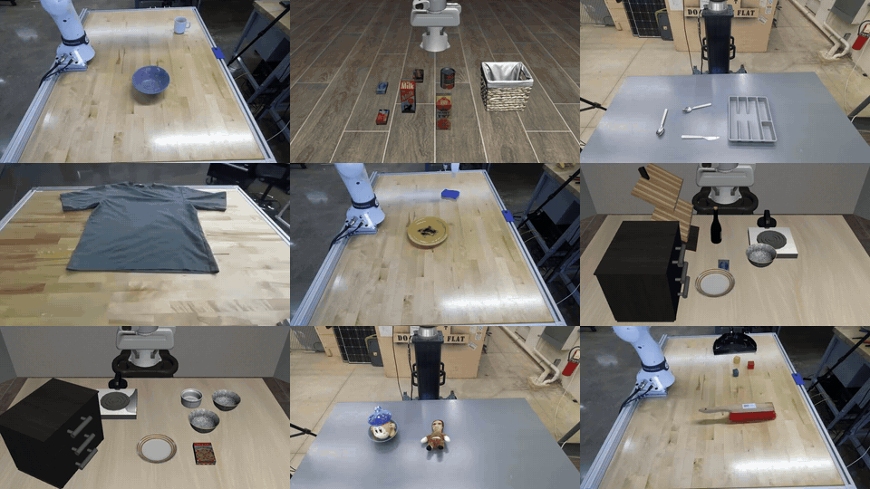

# SPARK: Sequential Planning via Anchored Robotic Keypoints

<p align="center">
  <a href="https://arxiv.org/abs/2606.30613"></a>
  <a href="https://cwru-aism.github.io/spark-page/"></a>
</p>

<p align="center">
  
</p>

SPARK writes a task once as a typed behavior tree over a small library of primitives. Each object in
the plan is bound to a 3D keypoint from SAM3 right before the action that uses it. When the scene
changes, SPARK finds the object again or recovers locally and keeps the plan. It needs no
task-specific training and no demonstrations. The planner is Qwen3.8-27B (4-bit), served locally
with vLLM.

Tested on a UR10e (Robotiq 2F-85), a Franka FR3, a bimanual Franka (Panda + FR3) and in LIBERO-PRO
simulation.

## Installation

Tested on Ubuntu 22.04 and 24.04 with CUDA 12.6.

```bash
git submodule update --init --recursive
sudo apt install libegl1 libgl1 libglvnd0
bash scripts/setup.sh
hf auth login   # accept https://huggingface.co/facebook/sam3 first
```

| GPU memory | What fits |
|---|---|
| 80 GB | planner and 3 to 8 simulator workers |
| 40 GB | planner (`VLLM_MEM=0.62`) and 2 workers |
| 24 GB (RTX 4090) | simulator only; serve the planner on another machine |

## Quick start

```bash
bash scripts/serve_planner.sh &   # vLLM on :8000, first start downloads about 16 GB
bash scripts/smoke.sh             # about 15 minutes
```

Run one LIBERO-PRO task (object suite, position perturbation, task 1, initial states 0 to 4):

```bash
bash scripts/run_item.sh results/one object position 1 0 5 wvrb_or_ph_rgs
python -m spark_bench.summarize results/one --cells
```

## Documentation

| Guide | Contents |
|---|---|
| [Setup](docs/setup.md) | Requirements, planner server, environment variables, pins, troubleshooting |
| [Reproduce the paper](docs/reproduce.md) | LIBERO-PRO and LIBERO-Displace runs, their scripts and protocol |
| [Real world deployment](docs/real_world.md) | UR10e, Franka FR3 and bimanual Franka: install, configuration, bring-up |

## Layout

```
scripts/          setup, planner server, smoke test, run and reproduction scripts
repro/            item lists of the reported runs
src/spark_core/   planner, prompts, SAM3 perception, binding (no robot code)
src/spark_bench/  LIBERO-PRO runner, executor and primitives, LIBERO-Displace
src/spark_real/   real world deployment: FastAPI server, drivers, calibration
third_party/      LIBERO, LIBERO-PRO, SAM3 (submodules at the pinned revisions)
```

## Citation

```bibtex
@misc{grant2026spark,
  title  = {Sequential Planning via Anchored Robotic Keypoints},
  author = {Grant, Bryce and Rothenberg, Aryeh and Senning, Logan
            and Chua, Zonghe and Patterson, Zach and Wang, Peng},
  year   = {2026},
  eprint = {2606.30613},
  archivePrefix = {arXiv}
}
```

## License

Apache-2.0. The submodules in `third_party/` ([LIBERO](https://github.com/Lifelong-Robot-Learning/LIBERO),
[LIBERO-PRO](https://github.com/Zxy-MLlab/LIBERO-PRO), [SAM3](https://github.com/facebookresearch/sam3))
and the model weights keep their own licenses.
